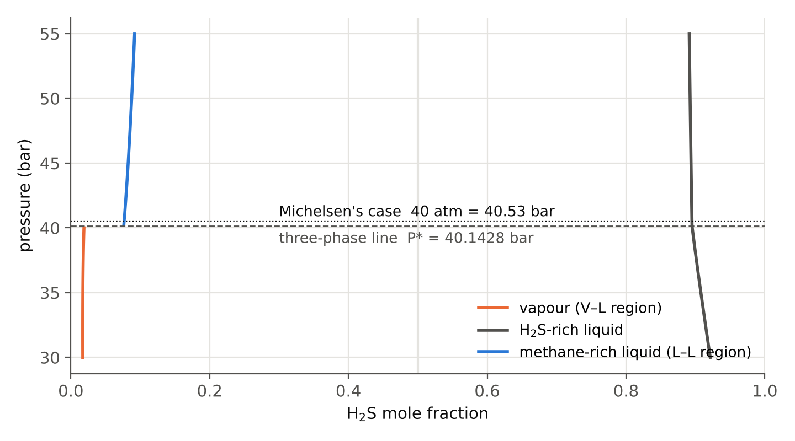

```{=html}
<style>
/* the site theme sets table headers in (small) capitals with letter spacing;
   keep math in headers exactly as MathJax draws it (ln, not LN) */
th .math, th .math *, th mjx-container, th mjx-container * {
  text-transform: none !important;
  font-variant: normal !important;
  font-variant-caps: normal !important;
  font-feature-settings: normal !important;
  letter-spacing: normal !important;
}
</style>
```

## Summary {.unnumbered}

A flash calculation answers one question: at a given temperature $T$, pressure $P$ and feed composition $\mathbf z$, how many phases are there, how much of each, and what are their compositions? For most mixtures, a textbook algorithm gets this right. Michelsen's 1982 test case, **methane/H₂S 50/50 with the Soave–Redlich–Kwong (SRK) equation at 190 K and 40 atm**, is a classic example where it does not.

At these conditions, a standard flash converges smoothly to a vapour-liquid split with **1.9 % and 89.4 % H₂S**. That split satisfies equal fugacities and closes the material balance, and its Gibbs energy is lower than the feed's. It is still **wrong**. The correct equilibrium is two **liquids** with **7.7 % and 89.5 % H₂S**.

This post works through the whole calculation number by number:

1. the equation of state and the root choice,
2. the stability test of the feed, with every iteration,
3. the first phase split, which converges to the wrong answer,
4. the checks that show it is wrong,
5. the second split, which gives the correct answer,
6. the checks that prove the correct answer is correct.

It ends with a general algorithm you can apply to any mixture. All numbers were produced by my own Python flash code and checked independently.

| | V–L split (wrong) | L–L split (correct) |
|---|---|---|
| H₂S-rich phase, H₂S mole fraction | 0.894275 | 0.895027 |
| methane-rich phase, H₂S mole fraction | 0.019245 | 0.076777 |
| methane-rich phase amount $\beta$ | 0.450585 | 0.482771 |
| $Z$ of the methane-rich phase | 0.53220 (vapour) | 0.16510 (dense liquid) |
| Gibbs energy $g = G/(nRT)$ | −2.684158 | **−2.685750** |
| stable? | no ($tm = -3.31\times10^{-3}$) | **yes** (all $tm \ge 0$) |

: The two converged splits at 190 K and 40.53 bar {#tbl-summary}

## The test case

| | methane | H₂S |
|---|---|---|
| $T_c$ (K) | 190.56 | 373.53 |
| $P_c$ (bar) | 45.99 | 89.607 |
| acentric factor $\omega$ | 0.0115 | 0.0942 |
| feed mole fraction $z_i$ | 0.5 | 0.5 |

: Component data {#tbl-comp}

The conditions are $T = 190$ K and $P = 40$ atm $= 4.053\times10^{6}$ Pa $= 40.53$ bar. The EOS is SRK with the classic van der Waals mixing rule and $k_{12} = 0.085$, the value in the NeqSim database. $R = 8.314$ J mol⁻¹ K⁻¹, so $RT = 1579.748$ J mol⁻¹.

This case is a hard one because $T = 190$ K is just below the critical temperature of methane (190.56 K). Methane-rich mixtures here can be gas-like or liquid-like depending on a few percent of H₂S. The pressure is also only 0.39 bar above the three-phase line of this binary (@sec-phase-rule).

## The equation of state

### SRK in brief

For each component:

$$
a_i = 0.42748\,\frac{R^2T_{c,i}^2}{P_{c,i}}\,\alpha_i, \qquad
\alpha_i = \left[1 + m_i\left(1-\sqrt{T/T_{c,i}}\right)\right]^2, \qquad
m_i = 0.480 + 1.574\,\omega_i - 0.176\,\omega_i^2
$$

$$
b_i = 0.08664\,\frac{RT_{c,i}}{P_{c,i}}
$$

For a phase with mole fractions $\mathbf w$:

$$
a = \sum_i\sum_j w_i w_j a_{ij}, \quad a_{ij} = \sqrt{a_i a_j}\,(1-k_{ij}), \qquad b = \sum_i w_i b_i
$$

$$
A = \frac{aP}{(RT)^2}, \qquad B = \frac{bP}{RT}
$$

The compressibility factor is a root of the cubic

$$
Z^3 - Z^2 + (A - B - B^2)\,Z - AB = 0
$$

and the fugacity coefficient of component $i$ is

$$
\ln\varphi_i = \underbrace{\frac{b_i}{b}(Z-1)}_{\text{term 1}}
\;\underbrace{-\,\ln(Z-B)}_{\text{term 2}}
\;\underbrace{-\,\frac{A}{B}\left(\frac{2\sum_j w_j a_{ij}}{a} - \frac{b_i}{b}\right)\ln\!\left(1+\frac{B}{Z}\right)}_{\text{term 3}}
$$

At 190 K:

| | methane | H₂S |
|---|---|---|
| $\sqrt{T/T_c}$ | 0.998530 | 0.713204 |
| $m$ | 0.498078 | 0.626709 |
| $\alpha$ | 1.001465 | 1.391780 |
| $a$ (Pa m⁶ mol⁻²) | 0.233679 | 0.640419 |
| $b$ (m³ mol⁻¹) | 2.98484 × 10⁻⁵ | 3.00287 × 10⁻⁵ |

The cross term is $a_{12} = \sqrt{0.233679 \times 0.640419}\,(1-0.085) = 0.386849 \times 0.915 = 0.353967$.

### The feed

For $\mathbf z = (0.5, 0.5)$: $a = 0.395508$, $b = 2.99385\times10^{-5}$, so $A = 0.642327$ and $B = 0.076810$. The cubic is

$$
Z^3 - Z^2 + 0.559617\,Z - 0.049337 = 0
$$

It has one real root, $Z = 0.106165$. Term by term:

| | methane | H₂S |
|---|---|---|
| $\sum_j z_j a_{ij}$ | 0.293823 | 0.497193 |
| $b_i/b$ | 0.996989 | 1.003011 |
| term 1 | −0.891144 | −0.896526 |
| term 2 $= -\ln(0.029355)$ | 3.528302 | 3.528302 |
| term 3 ($A/B = 8.362517$, $\ln(1+B/Z) = 0.544357$) | −2.225168 | −6.879215 |
| $\ln\varphi_i$ | **0.411990** | **−4.247439** |

With $Z = 0.106$ the feed is a dense phase. "Liquid-like" describes its density; it does not mean the feed is stable as a single liquid. Deciding that is the job of the stability test.

The two quantities used everywhere below are the reduced chemical potentials of the feed and its Gibbs energy:

$$
d_i = \ln z_i + \ln\varphi_i(\mathbf z) = (-0.281157,\; -4.940586)
$$

$$
g_{\text{feed}} = \sum_i z_i d_i = -2.610872
$$

### Choosing the root when there are three

Every $\ln\varphi$ evaluation needs one $Z$. When the cubic has three real roots, the middle one has no physical meaning. Of the other two, a bulk phase takes the one with the **lower Gibbs energy**, $\sum_i w_i(\ln w_i + \ln\varphi_i)$. The smallest root is not automatically "the liquid", and the largest is not automatically "the vapour".

For this system, three real roots exist only for 2.4–4.8 % H₂S on the methane-rich side. The Gibbs-energy choice jumps from the gas-like branch to the dense branch at **3.43 % H₂S** (@fig-roots).

{#fig-roots}

This matters because both methane-rich phases in this post sit just outside that band: the wrong vapour at 1.9 % H₂S, on the gas-like branch, and the correct light liquid at 7.7 % H₂S, on the dense branch.

## The Wilson estimate gets this case wrong

The usual first guess for the equilibrium ratios $K_i = y_i/x_i$ is Wilson's correlation:

$$
K_i^{W} = \frac{P_{c,i}}{P}\exp\!\left[5.373\,(1+\omega_i)\left(1-\frac{T_{c,i}}{T}\right)\right]
$$

| | $P_c/P$ | exponent | $K^W$ |
|---|---|---|---|
| methane | 1.134715 | −0.016018 | 1.116684 |
| H₂S | 2.210881 | −5.678937 | 0.007555 |

A two-phase solution of the Rachford–Rice equation needs $\sum z_iK_i > 1$ and $\sum z_i/K_i > 1$. Here $\sum z_iK_i = 0.5621 < 1$. Taken at face value, the Wilson K values say **the feed is a single liquid**, which is wrong. A flash that skips the stability test and trusts Wilson would stop here with one phase.

## Stability test of the feed

### The tangent plane criterion

A phase with composition $\mathbf z$ is stable if no trial phase $\mathbf w$ can lower the Gibbs energy by forming. Michelsen's tangent plane distance measures this:

$$
D(\mathbf w) = \sum_i w_i\left[\ln w_i + \ln\varphi_i(\mathbf w) - d_i\right]
$$

$D(\mathbf w)$ is the distance between the Gibbs energy surface at $\mathbf w$ and the tangent plane that touches it at $\mathbf z$. If $D(\mathbf w) \ge 0$ for every $\mathbf w$, the feed is stable. One $\mathbf w$ with $D < 0$ is enough to prove it unstable.

You cannot scan every $\mathbf w$ for a multicomponent mixture. Instead you look for the **stationary points** of $D$, where the minima sit. Working with unnormalised mole numbers $W_i$ makes this easy. Michelsen's modified function is

$$
tm(\mathbf W) = 1 + \sum_i W_i\left[\ln W_i + \ln\varphi_i(\mathbf w) - d_i - 1\right], \qquad \mathbf w = \mathbf W/\textstyle\sum_j W_j
$$

### Where the update formula comes from {#sec-update}

Setting $\partial\, tm/\partial W_i = 0$ gives, because $\sum_j W_j\,\partial\ln\varphi_j/\partial W_i = 0$ (the Gibbs–Duhem relation; the full derivation is in [Appendix A](#sec-appendix-a)),

$$
\ln W_i + \ln\varphi_i(\mathbf w) - d_i = 0
$$

Solving this for $W_i$ gives the successive substitution update

$$
\boxed{\;W_i^{\text{new}} = \exp\!\left[d_i - \ln\varphi_i(\mathbf w)\right]\;}
$$

At a stationary point the bracket in $tm$ equals $-1$, so

$$
tm^{*} = 1 - \sum_i W_i
$$

The sign of the converged $tm$ is therefore the sign of $1 - \sum W_i$. If $\sum W_i > 1$ the feed is unstable, and $\mathbf w$ is the composition of the new phase.

The sign of the **first** $tm$ means nothing. A trial can start positive and end negative, and in this example both do. Iterate until $tm$ stops changing.

### The two trials

Michelsen starts two trials from the Wilson K values:

- **vapour-like:** $W_i = K_i^W z_i$
- **liquid-like:** $W_i = z_i / K_i^W$

**Vapour-like trial**, $\mathbf W^{(0)} = (0.558342,\; 0.003778)$, $\sum W = 0.562119$:

| it | $W_1$ | $W_2$ | $\sum W$ | H₂S in $\mathbf w$ | $Z$ | $tm$ |
|---|---|---|---|---|---|---|
| 0 | 0.558342 | 0.003778 | 0.562119 | 0.006720 | 0.55503 | **+0.068778** |
| 1 | 1.069420 | 0.019684 | 1.089104 | 0.018073 | 0.53455 | −0.089310 |
| 2 | 1.068956 | 0.020366 | 1.089322 | 0.018696 | 0.53331 | −0.089323 |
| 3 | 1.068915 | 0.020408 | 1.089323 | 0.018735 | 0.53323 | −0.089323 |
| 10 | 1.068912 | 0.020411 | 1.089323 | 0.018737 | 0.53322 | **−0.089323** |

Iteration 0 in detail: $\ln\varphi(\mathbf w) = (-0.348274,\,-1.012613)$, so

$$
W_1^{\text{new}} = \exp(-0.281157 + 0.348274) = 1.069420, \qquad
W_2^{\text{new}} = \exp(-4.940586 + 1.012613) = 0.019684
$$

and

$$
tm^{(0)} = 1 + 0.558342(-0.649901 - 1) + 0.003778(-1.650719 - 1) = +0.068778
$$

**Liquid-like trial**, $\mathbf W^{(0)} = (0.447754,\; 66.181326)$, $\sum W = 66.63$:

| it | $W_1$ | $W_2$ | $\sum W$ | H₂S in $\mathbf w$ | $Z$ | $tm$ |
|---|---|---|---|---|---|---|
| 0 | 0.447754 | 66.181326 | 66.629081 | 0.993280 | 0.09181 | **+214.12** |
| 1 | 0.070738 | 0.978136 | 1.048875 | 0.932558 | 0.09288 | −0.058947 |
| 2 | 0.095948 | 0.966713 | 1.062662 | 0.909710 | 0.09331 | −0.064112 |
| 5 | 0.115155 | 0.950147 | 1.065303 | 0.891904 | 0.09367 | −0.065320 |
| 10 | 0.117841 | 0.947497 | 1.065338 | 0.889387 | 0.09372 | −0.065338 |
| 41 | 0.117942 | 0.947396 | 1.065338 | 0.889292 | 0.09372 | **−0.065338** |

![Left: $tm$ of the two feed trials. Both start positive and converge to negative values, so the feed is unstable. Right: convergence of the phase split by successive substitution, measured by $\sum_i[\ln(K_i^{new}/K_i^{old})]^2$, for the first (V–L) split and the corrected (L–L) split.](fig-convergence.png){#fig-convergence}

The liquid trial converges more slowly, in 41 iterations against 10, because it is close to the feed's own composition region. In practice you stop SS when the ratio of successive changes shows linear convergence and switch to a Newton step (Michelsen's $\alpha = 2\sqrt{W}$ variables). For a hand calculation, SS is easier to follow.

### From the trials to initial K values

Both trials give $tm < 0$, so the feed is unstable. Each converged trial also estimates one phase:

| Trial results | Initial K for the split |
|---|---|
| only the vapour-like trial is negative | $K_i = W_i^{v}/z_i$ (the feed stands in for the liquid) |
| only the liquid-like trial is negative | $K_i = z_i/W_i^{l}$ (the feed stands in for the vapour) |
| both are negative | $K_i = W_i^{v}/W_i^{l}$ |

Here:

$$
\mathbf K^{(0)} = \frac{(1.068912,\; 0.020411)}{(0.117942,\; 0.947396)} = (9.063041,\; 0.021544)
$$

The raw, unnormalised $W$ are used on purpose. For example, $\sum_i z_i W_i^v/z_i = \sum W^v > 1$ whenever the trial was negative, so the starting K values always allow a two-phase Rachford–Rice solution.

## The first phase split, and how it goes wrong

### The equations {#sec-split-equations}

For two phases with liquid $\mathbf x$, second phase $\mathbf y = \mathbf K\mathbf x$ and phase fraction $\beta$, the material balance gives the Rachford–Rice equation:

$$
\sum_i \frac{z_i(K_i-1)}{1+\beta(K_i-1)} = 0, \qquad
x_i = \frac{z_i}{1+\beta(K_i-1)}, \qquad y_i = K_ix_i
$$

For a binary there is no need to solve it. With $x_1 + x_2 = 1$ and $K_1x_1 + K_2x_2 = 1$:

$$
x_1 = \frac{1-K_2}{K_1-K_2}, \qquad y_1 = K_1x_1, \qquad \beta = \frac{z_1 - x_1}{y_1 - x_1}
$$

Successive substitution then updates

$$
K_i^{\text{new}} = \frac{\varphi_i(\mathbf x)}{\varphi_i(\mathbf y)}
$$

which makes the fugacities equal at convergence. Convergence is measured by

$$
\varepsilon = \sum_i\left[\ln\frac{K_i^{\text{new}}}{K_i^{\text{old}}}\right]^2
$$

The error uses the log of the K ratio, squared, rather than a plain difference of K values. The main reason is that $\ln K_i^{\text{new}} - \ln K_i^{\text{old}} = \ln f_i^{x} - \ln f_i^{y}$, so $\varepsilon$ measures the fugacity mismatch directly. [Appendix B](#sec-appendix-b) explains the choice in full.

The Gibbs energy of the split is

$$
g = (1-\beta)\,g_x + \beta\,g_y, \qquad g_{\text{phase}} = \sum_i w_i\left(\ln w_i + \ln\varphi_i\right)
$$

and it must decrease from one iteration to the next.

### Iteration 1 in detail

From $\mathbf K^{(0)} = (9.063041,\; 0.021544)$:

$$
x_1 = \frac{1 - 0.021544}{9.063041 - 0.021544} = 0.108218, \quad
y_1 = 9.063041 \times 0.108218 = 0.980787, \quad
\beta = \frac{0.5 - 0.108218}{0.980787 - 0.108218} = 0.448998
$$

The two phases:

| | $\mathbf x$ (H₂S-rich) | $\mathbf y$ (methane-rich) |
|---|---|---|
| composition (CH₄, H₂S) | (0.108218, 0.891782) | (0.980787, 0.019213) |
| $A$, $B$ | 0.942547, 0.076991 | 0.387114, 0.076588 |
| cubic roots | $Z = 0.093669$ | $Z = 0.532266$ |
| $\ln\varphi$ | (1.868039, −4.887978) | (−0.347767, −1.050502) |

New K values and error:

| | $\ln\varphi^x - \ln\varphi^y$ | $K^{\text{new}}$ | $\ln(K^{\text{new}}/K^{\text{old}})$ | squared |
|---|---|---|---|---|
| methane | 2.215806 | 9.168801 | 0.011601 | 1.3459 × 10⁻⁴ |
| H₂S | −3.837476 | 0.021548 | 0.000170 | 2.9 × 10⁻⁸ |
| | | | $\varepsilon$ | **1.35 × 10⁻⁴** |

Gibbs energy:

$$
g_x = 0.108218(-2.223609 + 1.868039) + 0.891782(-0.114533 - 4.887978) = -0.038479 - 4.461150 = -4.499629
$$

$$
g_y = 0.980787(-0.019404 - 0.347767) + 0.019213(-3.951965 - 1.050502) = -0.360115 - 0.096132 = -0.456247
$$

$$
g = 0.551002(-4.499629) + 0.448998(-0.456247) = \mathbf{-2.684149}
$$

That is already $0.0733$ below the feed, so splitting clearly pays.

### Convergence

| it | $K_1$ | $K_2$ | H₂S in $\mathbf x$ | H₂S in $\mathbf y$ | $\beta$ | $\varepsilon$ | $g$ |
|---|---|---|---|---|---|---|---|
| 1 | 9.063041 | 0.021544 | 0.891782 | 0.019213 | 0.448998 | 1.35e−4 | −2.6841491 |
| 2 | 9.168801 | 0.021548 | 0.893033 | 0.019243 | 0.449803 | 3.47e−5 | −2.6841559 |
| 3 | 9.222653 | 0.021535 | 0.893658 | 0.019245 | 0.450197 | 8.69e−6 | −2.6841576 |
| 5 | 9.263177 | 0.021524 | 0.894123 | 0.019245 | 0.450489 | 5.31e−7 | −2.6841581 |
| 10 | 9.276095 | 0.021520 | 0.894271 | 0.019245 | 0.450582 | 4.79e−10 | −2.6841582 |
| 20 | 9.276494 | 0.021520 | 0.894275 | 0.019245 | 0.450585 | 3.86e−16 | −2.6841582 |
| 38 | 9.276494 | 0.021520 | 0.894275 | 0.019245 | 0.450585 | 4.40e−27 | −2.6841582 |

The error falls by a steady factor of about 4 per iteration, as linear convergence should, and $g$ decreases monotonically. The result is a vapour ($Z = 0.5322$) with **1.92 % H₂S** and a liquid ($Z = 0.0936$) with **89.43 % H₂S**.

When I ran NeqSim's TPflash on the same case, it returned the same split: gas 1.92 % H₂S and liquid 89.42 % H₂S.

### It passes the usual checks

| check | result |
|---|---|
| fugacity of methane, $x_1\varphi_1^xP$ vs $y_1\varphi_1^yP$ | 28.074032 vs 28.074032 bar ($\Delta\ln f = 6.6\times10^{-14}$) |
| fugacity of H₂S | 0.272784 vs 0.272784 bar ($\Delta\ln f = 2.2\times10^{-15}$) |
| methane balance | $0.450585(0.980755) + 0.549415(0.105725) = 0.500000000000$ |
| H₂S balance | $0.450585(0.019245) + 0.549415(0.894275) = 0.500000000000$ |
| Gibbs energy vs feed | $-2.684158 < -2.610872$ |

Equal fugacities, a closed material balance and a lower Gibbs energy than the feed are necessary conditions for equilibrium. They are **not sufficient**. Equal fugacities only say the split is a stationary point of $G$. A stationary point can be a local minimum that is not the global one.

## The decisive check: stability of the split

At a converged split, both phases share the same chemical potentials:

$$
d_i = \ln x_i + \ln\varphi_i^x = \ln y_i + \ln\varphi_i^y = (-0.367197,\; -5.001119)
$$

These define a single tangent plane that touches the Gibbs surface at both $\mathbf x$ and $\mathbf y$. The split is the global minimum only if the **whole** Gibbs surface lies on or above this plane. Testing "phase $\mathbf x$" and testing "phase $\mathbf y$" therefore mean the same thing: both use the same $d$. The only difference is where the trials start.

Four trials were started from each phase: Wilson vapour-like, Wilson liquid-like, near-pure methane, and near-pure H₂S, the last two as dense trial phases.

| started from | trial | converged to (H₂S) | $tm$ | meaning |
|---|---|---|---|---|
| $\mathbf x$ | vapour-like $K^W x$ | **0.076145** | **−3.306 × 10⁻³** | **new phase: unstable** |
| $\mathbf x$ | liquid-like $x/K^W$ | 0.894275 | 0 | itself (trivial) |
| $\mathbf x$ | pure methane | 0.019245 | 0 | the other phase |
| $\mathbf x$ | pure H₂S | 0.894275 | 0 | itself |
| $\mathbf y$ | vapour-like $K^W y$ | 0.019245 | 0 | itself |
| $\mathbf y$ | liquid-like $y/K^W$ | 0.894275 | 0 | the other phase |
| $\mathbf y$ | pure methane | 0.019245 | 0 | itself |
| $\mathbf y$ | pure H₂S | 0.894275 | 0 | the other phase |

The vapour-like trial from $\mathbf x$ starts at $\mathbf W = (0.118061,\; 0.006756)$ with $tm = +0.615$. After one iteration $tm$ is already −0.0028, and after 43 iterations it settles at

$$
\mathbf u = (0.923855,\; 0.076145), \qquad Z_u = 0.16540, \qquad tm = 1 - \textstyle\sum W = -3.306\times10^{-3}
$$

All four trials started from $\mathbf y$ found nothing. They landed on one of the two known phases, which is a trivial answer. **A stability test that tries only one starting point, such as "test the vapour with a vapour-like guess", passes this wrong answer.** Use several trials, and discard any that converge to a phase you already have.

### Seeing it: the tangent plane distance

@fig-tpd plots $D(\mathbf w)$ along the whole composition line for both tangent planes.

{#fig-tpd}

A direct scan agrees with the trials:

| H₂S in trial | $Z$ | $D$ (V–L plane) | $D$ (L–L plane) |
|---|---|---|---|
| 0.0010 | 0.56414 | +0.01494 | +0.01855 |
| 0.0192 | 0.53229 | ≈ 0 | +0.00353 |
| 0.0340 | 0.49640 (3 roots) | +0.00428 | +0.00775 |
| 0.0500 | 0.18154 | −0.00065 | +0.00276 |
| **0.0761** | 0.16542 | **−0.00330** | ≈ 0 |
| 0.1000 | 0.15570 | −0.00173 | +0.00148 |
| 0.2000 | 0.13259 | +0.02201 | +0.02481 |
| 0.5000 (feed) | 0.10617 | +0.07329 | +0.07488 |
| 0.8943 | 0.09362 | ≈ 0 | ≈ 0 |
| 0.9990 | 0.09172 | +0.07730 | +0.07688 |

The negative region of the V–L plane runs from about 4.5 % to 11 % H₂S, on the dense branch of the cubic. A dense methane-rich phase there would lower $G$, so the vapour is not the stable methane-rich phase.

## The second split: the correct answer

The unstable trial $\mathbf u$ replaces the phase that was not stable. The split restarts from $\mathbf u$ and the H₂S-rich phase $\mathbf x$:

$$
\mathbf K^{(0)} = \frac{\mathbf u}{\mathbf x} = \frac{(0.923855,\; 0.076145)}{(0.105725,\; 0.894275)} = (8.738307,\; 0.085147)
$$

| it | $K_1$ | $K_2$ | H₂S in $\mathbf x$ | H₂S in $\mathbf u$ | $\beta$ | $\varepsilon$ | $g$ |
|---|---|---|---|---|---|---|---|
| 1 | 8.738307 | 0.085147 | 0.894275 | 0.076145 | 0.481922 | 2.18e−5 | −2.6857490 |
| 2 | 8.767200 | 0.085428 | 0.894656 | 0.076429 | 0.482331 | 5.98e−6 | −2.6857500 |
| 3 | 8.781392 | 0.085585 | 0.894844 | 0.076585 | 0.482542 | 1.66e−6 | −2.6857503 |
| 5 | 8.791702 | 0.085721 | 0.894983 | 0.076719 | 0.482708 | 1.34e−7 | −2.6857504 |
| 10 | 8.794789 | 0.085779 | 0.895026 | 0.076774 | 0.482768 | 2.96e−10 | −2.6857504 |
| 20 | 8.794869 | 0.085782 | 0.895027 | 0.076777 | 0.482771 | 1.91e−15 | −2.6857504 |
| 42 | 8.794869 | 0.085782 | 0.895027 | 0.076777 | 0.482771 | 7.05e−27 | −2.6857504 |

Even the first iteration has a lower $g$ (−2.685749) than the converged V–L split (−2.684158).

### Final result

| | H₂S-rich liquid | methane-rich liquid |
|---|---|---|
| amount | 0.517229 | 0.482771 |
| methane | 0.104973 | 0.923223 |
| H₂S | 0.895027 | 0.076777 |
| $Z$ | 0.093603 | 0.165098 |
| $\ln\varphi$ (CH₄, H₂S) | (1.883246, −4.889793) | (−0.290922, −2.433846) |

## Proof that the answer is the equilibrium

A flash result should pass five checks. These are the numbers for the L–L split.

**1. Equal fugacities.** $f_i = w_i\varphi_iP$:

| | H₂S-rich liquid | methane-rich liquid | $\Delta\ln f$ |
|---|---|---|---|
| methane | 0.104973 × 6.574814 × 40.53 = 27.972882 bar | 0.923223 × 0.747574 × 40.53 = 27.972882 bar | −9.1 × 10⁻¹⁵ |
| H₂S | 0.895027 × 0.007523 × 40.53 = 0.272900 bar | 0.076777 × 0.087699 × 40.53 = 0.272900 bar | +8.6 × 10⁻¹⁴ |

**2. Material balance.**

$$
\text{CH}_4: 0.482771(0.923223) + 0.517229(0.104973) = 0.445705 + 0.054295 = 0.500000000000
$$

$$
\text{H}_2\text{S}: 0.482771(0.076777) + 0.517229(0.895027) = 0.037066 + 0.462934 = 0.500000000000
$$

**3. Lowest Gibbs energy found.**

$$
g_x = 0.104973(-2.254053 + 1.883246) + 0.895027(-0.110901 - 4.889793) = -4.514681
$$

$$
g_u = 0.923223(-0.079885 - 0.290922) + 0.076777(-2.566848 - 2.433846) = -0.726277
$$

$$
g = 0.517229(-4.514681) + 0.482771(-0.726277) = -2.685750
$$

| | $g$ |
|---|---|
| single-phase feed | −2.610872 |
| V–L split | −2.684158 |
| **L–L split** | **−2.685750** ($1.59\times10^{-3}$ below V–L) |

The difference looks small, but it is a difference in $G/(nRT)$, and it decides which answer is the equilibrium.

**4. Stability of each phase.** All eight trials converge to $\mathbf x$ or $\mathbf u$ with $tm = 0$, with one exception. The near-pure-methane trial converges to a gas-like composition with 1.93 % H₂S and $tm = +3.525\times10^{-3}$. That stationary point is *positive*: it is the old vapour, now a **metastable** phase that lies above the new tangent plane. A positive stationary point does not make a split unstable.

**5. Tangent plane scan.** For a binary, the whole composition line can be scanned. The minimum of $D$ on the L–L plane is $+1.0\times10^{-10}$, at the H₂S-rich phase itself. No composition lies below the plane (blue curve in @fig-tpd).

## Why the wrong answer is so tempting: the phase rule {#sec-phase-rule}

For a binary at fixed $T$, three phases can coexist only at a single pressure. A scan of flash results at 190 K and $z = 0.5$ (@fig-pscan) finds the vapour-liquid-liquid pressure:

$$
P^{*} = 40.1428 \text{ bar}
$$

Below $P^*$, the stable split is vapour + H₂S-rich liquid. Above $P^*$, it is methane-rich liquid + H₂S-rich liquid. Michelsen's 40 atm (40.53 bar) is only 0.39 bar above the line. At that pressure, the vapour-liquid split still exists as a local minimum of $G$, slightly above the global one, so an algorithm without a proper stability test happily converges to it.

{#fig-pscan}

Exactly at $P^*$, a T–P flash of the binary is degenerate. The three phase compositions are fixed, but their amounts are not: any combination on the tie triangle satisfies the material balance with the same $G$. To get a real three-phase region in T–P space you need a third component (@sec-ternary).

## The general algorithm

The methane/H₂S case shows every decision a robust two-phase flash has to make.

```{mermaid}
flowchart TD
    A["Input T, P, z"] --> B["EOS of the feed<br/>lower-G root, d = ln z + ln φ(z)"]
    B --> C["Stability test of the feed<br/>vapour-like W = K_w z and liquid-like W = z/K_w<br/>iterate W ← exp(d − ln φ(w)) until tm converges"]
    C -->|"all tm ≥ 0"| S["Single phase"]
    C -->|"some tm < 0"| D["Initial K from the negative trial(s)<br/>W_v/W_l, W_v/z or z/W_l"]
    D --> E["Split: Rachford–Rice, then K ← φ_x/φ_y<br/>accelerate or Newton; G must decrease"]
    E --> F["Check: equal fugacities, material balance,<br/>G below the feed"]
    F --> G["Stability test of the split<br/>several trials from each phase, same d"]
    G -->|"all non-trivial tm ≥ 0"| H["Equilibrium found"]
    G -->|"a trial with tm < 0<br/>(new composition u)"| I["Replace the unstable phase by u<br/>K = u/x"]
    I --> E
```

The same logic in compact Python:

```python
def flash_tp(eos, T, P, z):
    d = ln(z) + ln_phi(eos, T, P, z)                 # feed chemical potentials
    trials = stability_trials(eos, T, P, d, starts=[Kw*z, z/Kw])
    neg = [t for t in trials if t.tm < -1e-8 and not t.trivial]
    if not neg:
        return single_phase(z)

    K = initial_K(neg, z)                            # Wv/Wl, Wv/z or z/Wl
    while True:
        x, y, beta = split(eos, T, P, z, K)          # RR + SS (+ Newton), G decreasing
        d = ln(x) + ln_phi(eos, T, P, x)             # tangent plane of the split
        starts = [Kw*x, x/Kw, Kw*y, y/Kw, pure_light, pure_heavy]
        new = [t for t in stability_trials(eos, T, P, d, starts)
               if t.tm < -1e-8 and not same_as(t.w, x, y)]
        if not new:
            return x, y, beta                        # verified equilibrium
        u = min(new, key=lambda t: t.tm).w
        # replace the phase whose swap keeps the feed between the two phases (0 < beta < 1)
        K = u / x if rr_feasible(z, u / x) else y / u
```

Things to remember:

1. **Wilson K values are only a starting point.** Here they predicted one liquid phase.
2. **Iterate the stability test to convergence.** The first $tm$ was positive in every trial here.
3. **Use the lower-Gibbs-energy root** for every phase and trial composition. "Smallest root = liquid" fails in a three-root region.
4. **Equal fugacities are necessary but not sufficient.** The V–L split had fugacities equal to $10^{-14}$ and was still wrong.
5. **Test the converged split for stability with several starting points**, and discard trials that return to an existing phase.
6. **A positive stationary point is a metastable phase**, not a sign of instability.
7. **Measure convergence in $\ln K$ (fugacity) space.** It treats all components fairly and is symmetric in the phases.

## Beyond the binary: a real three-phase region {#sec-ternary}

Adding CO₂ turns the binary's single three-phase pressure into a band. For Michelsen's ternary, methane/CO₂/H₂S 50/10/40 with SRK, a three-phase flash (Michelsen's $Q$-function for the phase amounts, plus a stability test of every phase) gives at **181 K and 28 bar**:

| | H₂S-rich liquid | methane-rich liquid | vapour |
|---|---|---|---|
| amount | 0.5067 | 0.2759 | 0.2174 |
| methane | 0.1353 | 0.7983 | 0.9714 |
| CO₂ | 0.1365 | 0.0967 | 0.0192 |
| H₂S | 0.7282 | 0.1050 | 0.0094 |
| $Z$ | 0.068 | 0.094 | 0.676 |

Checks on this result:

- Fugacities agree in all three phases to $|\Delta\ln f| < 2\times10^{-11}$.
- The Gibbs energy is $6.7\times10^{-4}$ below the best two-phase answer.
- Every phase is stable against the other two.
- A scan of 79,800 compositions over the composition triangle found no point below the tangent plane.

At 181 K, three phases exist from about 27.7 to 28.2 bar. Below that band the mixture is liquid + vapour, and above it two liquids, the same switch as in @fig-pscan, now spread over a pressure range.

## References {.unnumbered}

1. M. L. Michelsen, "The isothermal flash problem. Part I. Stability," *Fluid Phase Equilibria* **9** (1982) 1–19.
2. M. L. Michelsen, "The isothermal flash problem. Part II. Phase-split calculation," *Fluid Phase Equilibria* **9** (1982) 21–40.
3. M. L. Michelsen and J. M. Mollerup, *Thermodynamic Models: Fundamentals & Computational Aspects*, 2nd ed., Tie-Line Publications (2007).
4. G. Soave, "Equilibrium constants from a modified Redlich–Kwong equation of state," *Chemical Engineering Science* **27** (1972) 1197–1203.
5. H. H. Rachford and J. D. Rice, "Procedure for use of electronic digital computers in calculating flash vaporization hydrocarbon equilibrium," *Journal of Petroleum Technology* **4**(10) (1952), section 1 p. 19 and section 2 p. 3.
6. G. M. Wilson, "A modified Redlich–Kwong equation of state, application to general physical data calculations," AIChE 65th National Meeting, Cleveland (1969).
7. Equinor, NeqSim documentation, "TPflash algorithm": <https://github.com/equinor/neqsim/blob/master/docs/thermodynamicoperations/TPflash_algorithm.md>

## Appendix A: Derivation of the stability update {#sec-appendix-a .unnumbered}

This appendix proves the stationary condition used in [Where the update formula comes from](#sec-update). Temperature and pressure are fixed throughout, and $d_i = \ln z_i + \ln\varphi_i(\mathbf z)$ are constants of the feed.

### Step-by-step differentiation {.unnumbered}

The modified tangent plane distance is

$$
tm(\mathbf W) = 1 + \sum_k W_k\left(\ln W_k + \ln\varphi_k(\mathbf w) - d_k - 1\right), \qquad \mathbf w = \frac{\mathbf W}{\sum_j W_j}
$$

Differentiate with respect to $W_i$, applying the product rule to each term of the sum:

$$
\frac{\partial\, tm}{\partial W_i} = \frac{\partial}{\partial W_i}\left[1 + \sum_k W_k\left(\ln W_k + \ln\varphi_k(\mathbf w) - d_k - 1\right)\right]
$$

**1. The term $W_k\ln W_k$.** Only $k = i$ depends on $W_i$:

$$
\frac{\partial}{\partial W_i}\left(\sum_k W_k\ln W_k\right) = \ln W_i + W_i\cdot\frac{1}{W_i} = \ln W_i + 1
$$

**2. The term $-W_k(d_k + 1)$.** The $d_k$ are constants:

$$
\frac{\partial}{\partial W_i}\left(-\sum_k W_k(d_k + 1)\right) = -(d_i + 1) = -d_i - 1
$$

**3. The term $W_k\ln\varphi_k(\mathbf w)$.** Here both factors depend on $W_i$, because $\mathbf w$ depends on every $W_j$:

$$
\frac{\partial}{\partial W_i}\left(\sum_k W_k\ln\varphi_k(\mathbf w)\right) =
\underbrace{\ln\varphi_i(\mathbf w)}_{\text{differentiating } W_k} +
\underbrace{\sum_k W_k\,\frac{\partial\ln\varphi_k(\mathbf w)}{\partial W_i}}_{\text{differentiating } \ln\varphi_k(\mathbf w)}
$$

### Applying the Gibbs–Duhem relation {.unnumbered}

At fixed $T$ and $P$, $\ln\varphi_k$ depends only on the mole fractions $\mathbf w$, not on the total amount. Treating $\mathbf W$ as mole numbers, $\ln\varphi_k$ is therefore homogeneous of degree zero in $\mathbf W$, and $\sum_k W_k\ln\varphi_k$ is the residual Gibbs energy $G^{\text{res}}/RT$, homogeneous of degree one. The Gibbs–Duhem relation for the residual part then gives

$$
\sum_k W_k\,\frac{\partial\ln\varphi_k(\mathbf w)}{\partial W_i} = 0
$$

So the derivative simplifies to

$$
\frac{\partial\, tm}{\partial W_i} = (\ln W_i + 1) + (-d_i - 1) + \ln\varphi_i(\mathbf w) + 0
$$

and, combining like terms,

$$
\frac{\partial\, tm}{\partial W_i} = \ln W_i + \ln\varphi_i(\mathbf w) - d_i
$$

### Setting the derivative to zero {.unnumbered}

A stationary point of $tm$ requires $\partial\, tm/\partial W_i = 0$ for every component:

$$
\ln W_i + \ln\varphi_i(\mathbf w) - d_i = 0
$$

Solving for $W_i$ gives the successive substitution update of the stability test,

$$
W_i = \exp\!\left[d_i - \ln\varphi_i(\mathbf w)\right]
$$

### Value of $tm$ at the stationary point {.unnumbered}

Substituting $\ln W_i + \ln\varphi_i(\mathbf w) - d_i = 0$ back into $tm$, each bracket reduces to $-1$:

$$
tm^{*} = 1 + \sum_k W_k(0 - 1) = 1 - \sum_k W_k
$$

So a converged trial with $\sum_k W_k > 1$ has $tm^{*} < 0$, and the phase being tested is unstable.

## Appendix B: Why the convergence error uses squared log ratios {#sec-appendix-b .unnumbered}

The phase split in [the split equations](#sec-split-equations) is converged with

$$
\varepsilon = \sum_i\left[\ln\frac{K_i^{\text{new}}}{K_i^{\text{old}}}\right]^2
$$

### 1. Why logarithms ($\ln$) are used {.unnumbered}

**Scale invariance.** $K$ values span several orders of magnitude across components and conditions, from about $10^{-4}$ for heavy hydrocarbons to $10^{2}$ for light gases. In this post alone, methane has $K \approx 9$ and H₂S has $K \approx 0.02$. If you checked absolute differences such as $\sum_i(K_i^{\text{new}} - K_i^{\text{old}})^2$, the heavy components would be effectively ignored and the light components would dominate the error.

**Proportional change.** The natural log turns multiplicative changes into additive ones:

$$
\ln\frac{K_i^{\text{new}}}{K_i^{\text{old}}} = \ln K_i^{\text{new}} - \ln K_i^{\text{old}}
$$

This measures the relative change from one iteration to the next, not the absolute difference. Moving from $K = 0.01$ to $0.02$ is the same relative step as moving from $10$ to $20$: both give $\ln 2 = 0.693$.

In iteration 1 of the example:

| | $K^{\text{old}} \to K^{\text{new}}$ | $(\Delta K)^2$ | $(\Delta\ln K)^2$ |
|---|---|---|---|
| methane | 9.063041 → 9.168801 | 1.1 × 10⁻² | 1.35 × 10⁻⁴ |
| H₂S | 0.0215443 → 0.0215479 | 1.3 × 10⁻¹¹ | 2.9 × 10⁻⁸ |

With plain differences, H₂S looks almost a billion times better converged than methane. With logs, it is about 4,700 times better, which matches the real relative changes of 1.2 % and 0.017 %.

### 2. Why it is squared ($[\dots]^2$) {.unnumbered}

**No sign cancellation.** $\ln(K^{\text{new}}/K^{\text{old}})$ is positive or negative depending on whether a $K$ value rose or fell in that iteration. Squaring each component's term stops positive and negative errors from cancelling when they are summed.

**Least-squares norm.** $\varepsilon$ is the squared Euclidean norm of the vector $\Delta\ln\mathbf K$. It penalises large remaining errors heavily and decreases smoothly near convergence, like the norms or root-mean-square errors used in other multivariable convergence checks. With linear convergence, $\varepsilon$ falls by a constant factor per iteration, about 4 in this example (@fig-convergence).

### 3. What the error means thermodynamically {.unnumbered}

**It is the fugacity mismatch.** The successive substitution update is $K_i^{\text{new}} = \varphi_i^x/\varphi_i^y$, and the current phases satisfy $K_i^{\text{old}} = y_i/x_i$. Therefore

$$
\ln K_i^{\text{new}} - \ln K_i^{\text{old}} = (\ln x_i + \ln\varphi_i^x) - (\ln y_i + \ln\varphi_i^y) = \ln f_i^{x} - \ln f_i^{y} = \frac{\mu_i^x - \mu_i^y}{RT}
$$

Each term of $\varepsilon$ is the squared difference in chemical potential of component $i$ between the two phases. Equilibrium means $f_i^x = f_i^y$, so $\varepsilon = 0$ is exactly the equilibrium condition, not an approximation of it.

**It does not depend on how the phases are labelled.** Swapping the two phases turns every $K$ into $1/K$. That only changes the sign of $\ln K$, so $\varepsilon$ is unchanged. A plain difference of $K$ values gives a different error for the same physical state, depending on which phase is called $x$.

**It protects trace components.** Suppose a trace component has $K = 10^{-6}$ and its true value is $2\times10^{-6}$, an error of 100 %. The plain difference is only $10^{-6}$ and would report it as converged. The log difference is $\ln 2 = 0.69$ and correctly reports it as not converged.
