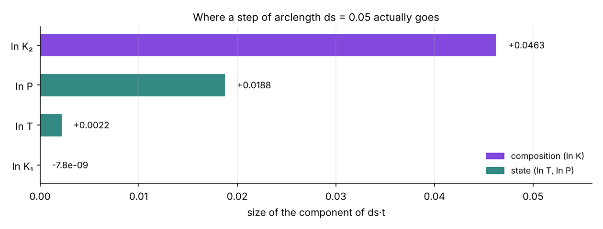
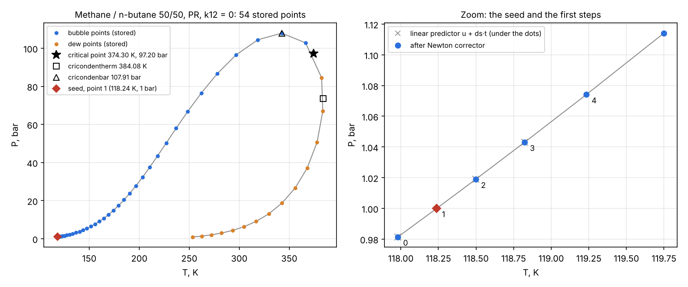

A 50/50 methane / n-butane mixture, Peng–Robinson, k12 = 0. This post walks through every step of the continuation tracer that builds its phase envelope:

- the first point is seeded at 1 bar, with T from Wilson K-values by bisection, and polished by Newton;

- each later point is a linear extrapolation along the tangent (the slope of the curve), corrected back onto the curve by Newton.

The result is a closed envelope with its critical point at 374.30 K, 97.20 bar, a cricondentherm of 384.08 K and a cricondenbar of 107.91 bar. It passes all five checks.

## 1. The mixture and the Peng-Robinson parameters

The feed is z = (0.5, 0.5) methane / n-butane, k12 = 0, R = 8.314462618 J/(mol K). Every quantity is in SI units (Pa, m³/mol); pressures are quoted in bar.

| Component | Tc, K | Pc, bar | omega | m | ac, Pa m⁶/mol² | b, m³/mol |
|---|---|---|---|---|---|---|
| methane | 190.564 | 45.992 | 0.01142 | 0.392217 | 0.249581 | 2.680232e-5 |
| n-butane | 425.12 | 37.96 | 0.2008 | 0.673442 | 1.504906 | 7.244345e-5 |

The pure-component parameters:

$$
m_i = 0.37464 + 1.54226\,\omega_i - 0.26992\,\omega_i^2, \qquad a_{c,i} = 0.45724\,\frac{R^2 T_{c,i}^2}{P_{c,i}}, \qquad b_i = 0.07780\,\frac{R\,T_{c,i}}{P_{c,i}}
$$

$$
\alpha_i(T) = \left[1 + m_i\left(1 - \sqrt{T/T_{c,i}}\right)\right]^2, \qquad a_i(T) = a_{c,i}\,\alpha_i(T)
$$

At the seed temperature T = 118.23883 K (section 3): alpha = (1.173471, 1.737867), so a1 = 0.292876 and a2 = 2.615327 Pa m⁶/mol².

The van der Waals mixing rules, for any phase composition x:

$$
a_{ij} = \sqrt{a_i a_j}\,(1-k_{ij}), \qquad a_m = \sum_i\sum_j x_i x_j a_{ij}, \qquad b_m = \sum_i x_i b_i
$$

For the feed at 118.23883 K: a12 = 0.875196, am = 1.164649 Pa m⁶/mol² and bm = 4.962288e-5 m³/mol. For the incipient vapour of section 3 (almost pure methane): am = 0.292877 and bm = 2.680233e-5.

At a given (T, P) each phase has A = am P/(RT)^2 and B = bm P/(RT), and its Z is a root of the PR cubic:

$$
Z^3 - (1-B)\,Z^2 + (A - 3B^2 - 2B)\,Z - (AB - B^2 - B^3) = 0
$$

Its fugacity coefficients are:

$$
\ln\varphi_i = \frac{b_i}{b_m}(Z-1) - \ln(Z-B) - \frac{A}{2\sqrt{2}\,B}\left(\frac{2\sum_j x_j a_{ij}}{a_m} - \frac{b_i}{b_m}\right)\ln\frac{Z+(1+\sqrt{2})B}{Z+(1-\sqrt{2})B}
$$

When the cubic has three real roots, the phase takes the one with the lower Gibbs energy, the smaller sum of x\_i ln phi\_i.

## 2. The equations the tracer solves

At every envelope point the feed z is the bulk phase and a second phase y = K z appears in zero amount. On the bubble side y is the incipient vapour; on the dew side it is the incipient liquid. The same equations cover both. The unknowns are

$$
\mathbf{u} = (\ln K_1,\ \ln K_2,\ \ln T,\ \ln P)
$$

and the three residuals are fugacity equality for each component plus the sum of the incipient phase:

$$
R_i(\mathbf{u}) = \ln K_i + \ln\varphi_i(T,P,\mathbf{y}) - \ln\varphi_i(T,P,\mathbf{z}),\quad i = 1,2
$$

$$
R_3(\mathbf{u}) = \sum_i z_i K_i - 1
$$

There are three equations and four unknowns, so the solutions form a curve: the envelope. Any single point is found by holding one of the four unknowns fixed (pinning it) and solving the remaining 3 × 3 system by Newton:

$$
J_{\text{free}}\,\Delta\mathbf{u}_{\text{free}} = -\mathbf{R},\qquad J = \partial\mathbf{R}/\partial\mathbf{u}\ (3\times 4)
$$

$J_{\text{free}}$ is J with the pinned column removed. Two details matter for the numbers below. First, a step whose largest component is too large is scaled down, so the direction is kept and only the length is cut. Second, Newton stops when the norm of R falls below a tight tolerance.

The tracer builds the curve in two moves:

1. **Seed.** Hold ln P at 1 bar and solve for the first point (section 3).

2. **Step.** From a converged point, extrapolate linearly along the tangent of the curve, then correct back onto the curve by Newton (section 4). Repeat.

## 3. Point 1: the seed at 1 bar

**Wilson K-values.** At fixed P = 1 bar, each K depends only on T:

$$
K_i(T) = \frac{P_{c,i}}{P}\,\exp\!\left[5.37\,(1+\omega_i)\left(1-\frac{T_{c,i}}{T}\right)\right]
$$

**Bisection on the bubble condition.** The seed temperature is the root of
f(T) = Σ z\_i K\_i(T) − 1. The bracket is [20 K, 2·max Tc] = [20 K, 850.24 K]:

$$
f(20\ \text{K}) = -1.000000, \qquad f(850.24\ \text{K}) = +2031.154
$$

At 20 K both K are numerically zero, so the sum is 1.8e-19 and everything is
liquid; at 850.24 K the sum is 2032 and everything is vapour. The signs differ,
so a root lies between. Each iteration takes the midpoint: if Σ z K &gt; 1 there
the midpoint is too hot and becomes the upper bound, otherwise it becomes the
lower bound.

| Step | lo, K | hi, K | midpoint, K | Σ z K at midpoint | Decision |
|---|---|---|---|---|---|
| 1 | 20.000 | 850.240 | 435.120 | 5.0886e+2 | too hot, hi = mid |
| 2 | 20.000 | 435.120 | 227.560 | 5.5678e+1 | too hot, hi = mid |
| 3 | 20.000 | 227.560 | 123.780 | 1.2274 | too hot, hi = mid |
| 4 | 20.000 | 123.780 | 71.890 | 2.9364e-3 | too cold, lo = mid |
| 5 | 71.890 | 123.780 | 97.835 | 1.3365e-1 | too cold, lo = mid |
| 6 | 97.835 | 123.780 | 110.808 | 4.6116e-1 | too cold, lo = mid |
| 7 | 110.808 | 123.780 | 117.294 | 7.7300e-1 | too cold, lo = mid |
| 8 | 117.294 | 123.780 | 120.537 | 9.8014e-1 | too cold, lo = mid |
| 9 | 120.537 | 123.780 | 122.158 | 1.0985 | too hot, hi = mid |
| 10 | 120.537 | 122.158 | 121.348 | 1.0380 | too hot, hi = mid |
| 11 | 120.537 | 121.348 | 120.942 | 1.0088 | too hot, hi = mid |
| 12 | 120.537 | 120.942 | 120.740 | 9.9437e-1 | too cold, lo = mid |

By step 3 the bracket is [20, 123.78]; by step 12 it is 0.4 K wide. Bisection
halves the interval every iteration regardless of the function, so after 60
halvings the width is 830.24/2⁶⁰ ≈ 7e-16 K. The method is slow but cannot fail
inside a sign-changing bracket.

**Wilson's answer.** T₀ = 120.819155 K, with

$$
K_1 = 1.9999966,\quad K_2 = 3.357041\times 10^{-6},
\qquad \sum_i z_i K_i - 1 = 6.7\times 10^{-16}
$$

$$
\ln K_1 = 0.6931455, \qquad \ln K_2 = -12.604451
$$

Note that K₁ has already landed on 2 = 1/z₁ to seven digits. With K₂ of order
10⁻⁶, the bubble condition 0.5 K₁ + 0.5 K₂ = 1 forces it. This stays true all
the way to the converged seed, and it is a useful sanity check: at the cold end
of a bubble line the incipient vapour is essentially the light component alone.

**Newton with ln P pinned at 1 bar.** Start from u₀ = (ln 1.9999966, ln 3.357041e-6, ln 120.819155, ln 10⁵ Pa) = (0.6931455, −12.604451, 4.7942948, 11.5129255). Because ln P is pinned, it never changes. The free unknowns are ln K₁, ln K₂ and ln T.

What one iteration does. Each iteration takes the current u and makes five moves:

1. **Unpack u.** Compute T = exp(ln T) and Kᵢ = exp(ln Kᵢ), then the incipient vapour yᵢ = zᵢ Kᵢ. The liquid is the feed, x = z.

2. **Run Peng–Robinson twice, at (T, 1 bar).** Do this once for the liquid z and once for the vapour y, with section 1's formulas: αᵢ(T), aᵢ, then a\_m and b\_m for that composition, A and B, the cubic in Z (smallest root for the liquid, largest for the vapour), then ln φᵢ.

3. **Residuals.** R₁ = ln K₁ + ln φ₁ᵛ − ln φ₁ᴸ, R₂ = ln K₂ + ln φ₂ᵛ − ln φ₂ᴸ, and R₃ = y₁ + y₂ − 1. If the norm of R is below the tolerance, stop.

4. **Jacobian and linear solve.** $J_{\text{free}}$ holds the 3 × 3 derivatives of (R₁, R₂, R₃) with respect to (ln K₁, ln K₂, ln T). Solve $J_{\text{free}}$ Δu = −R for the full Newton step Δu.

5. **Cap and update.** If the largest component of Δu exceeds the cap, scale the whole step so that it sits at the cap. The direction is kept and only the length is cut. Add the step to (ln K₁, ln K₂, ln T).

Seven iterations carry the Wilson guess to the seed. Below is the first one in
full, then all seven side by side.

### Iteration 0, longhand

**Move 1, unpack.** T = 120.819155 K, K = (1.9999966, 3.357041e-6), so

$$
\mathbf{y} = \mathbf{K}\mathbf{z} = (0.9999983,\ 1.678520\times 10^{-6}),
\qquad \textstyle\sum_i y_i = 1.0000000203
$$

**Move 2, Peng–Robinson twice at 120.819155 K and 1 bar.** The temperature-dependent
part is shared by both phases:

$$
\alpha = (1.166218,\ 1.727719), \qquad a = (0.291066,\ 2.600056)\ \text{Pa m}^6/\text{mol}^2
$$

| Phase | Composition | a\_m | b\_m | A | B |
|---|---|---|---|---|---|
| Liquid | z = (0.5, 0.5) | 1.157748 | 4.962288e-5 | 0.1147293 | 0.0049398 |
| Vapour | y = (0.9999983, 1.6785e-6) | 0.291068 | 2.680239e-5 | 0.0288439 | 0.0026681 |

Each cubic has three real roots here, so each phase has a choice to make. Listing
every root with its Gibbs energy[^gibbs] shows how that choice is settled:

**Liquid, z:**

| Z | ln φ₁ | ln φ₂ | Gres/RT | |
|---|---|---|---|---|
| **0.0054562** | +0.843510 | −14.443153 | **−6.7998216** | ← used, lowest |
| 0.1134202 | +1.293308 | −0.565000 | +0.3641538 | middle root, unstable |
| 0.8761838 | +0.010710 | −0.243098 | −0.1161936 | |

**Vapour, y:**

| Z | ln φ₁ | ln φ₂ | Gres/RT | |
|---|---|---|---|---|
| 0.0034875 | +0.654867 | −13.451857 | +0.6548431 | |
| 0.0205701 | +1.791107 | −2.725370 | +1.7910998 | middle root, unstable |
| **0.9732743** | −0.026446 | −0.139185 | **−0.0264464** | ← used, lowest |

Neither decision is close: the chosen root is lower by 6.68 in G/RT for the
liquid and by 0.51 for the vapour. Gres/RT is the composition-weighted
sum of the ln φ columns beside it, so for the liquid
0.5(0.843510) + 0.5(−14.443153) = −6.7998216. The middle root is highest in both
tables, as it always is: it lies on the branch where ∂P/∂V &gt; 0 and is
mechanically unstable.

[^gibbs]: Only the *residual* Gibbs energy, Gres/RT = Σᵢ xᵢ ln φᵢ, is
    needed for the comparison. The ideal-gas contribution to G is identical for
    every root at the same T, P and composition, so it cancels and cannot change
    which root wins.

"Smallest root for the liquid, largest for the vapour" is a shortcut for that
rule rather than a second rule. It agrees with the Gibbs comparison at every
phase evaluation on this envelope — 108 evaluations over the 54 stored points,
no disagreements — and in 56 of them the cubic has only one real root, so no
choice arises at all. The shortcut is not safe in general: where the two outer
roots approach equal Gibbs energy they exchange places, and code that assumes
the largest root is the vapour will follow a metastable branch across that
crossing.

**Move 3, residuals.**

$$
R_1 = 0.6931455 + (-0.026446) - 0.843510 = -0.176810
$$

$$
R_2 = -12.604451 + (-0.139185) - (-14.443153) = +1.699517
$$

$$
R_3 = 1.0000000203 - 1 = 2.03\times 10^{-8},
\qquad \lVert\mathbf{R}\rVert = 1.71
$$

R₂ carries almost all of the error. The Wilson estimate put n-butane's K-value
about a factor of 10 too high, and 1.70 in ln terms is exactly that.

**Move 4, Jacobian and solve.** J is 3 × 4, but ln P is pinned, so its column is
dropped and what is solved is the 3 × 3 block in (ln K₁, ln K₂, ln T). The nine
entries come from three different places.

*The R₃ row is exact.* R₃ contains no fugacity coefficients at all, so its
derivatives follow in two lines rather than from any thermodynamics. Written out
in the unknowns themselves:

$$
R_3(\mathbf{u}) = z_1 e^{\ln K_1} + z_2 e^{\ln K_2} - 1
$$

The feed composition z is fixed data, not an unknown. Differentiating with
respect to ln Kᵢ, only the i-th term survives — the other is constant in that
variable — and the exponential is its own derivative:

$$
\frac{\partial R_3}{\partial \ln K_i}
= \frac{\partial}{\partial \ln K_i}\left(z_i e^{\ln K_i}\right)
= z_i e^{\ln K_i} = z_i K_i,
\qquad
\frac{\partial}{\partial \ln K_i}\left(z_j e^{\ln K_j}\right) = 0 \ \ (j \neq i)
$$

This is the general identity ∂q/∂ln q = q, and it is one of the reasons the
unknowns are carried as logarithms: derivatives come back as the quantity itself,
with no extra factors to track.

Neither ln T nor ln P appears anywhere in that expression, so

$$
\frac{\partial R_3}{\partial \ln T} = \frac{\partial R_3}{\partial \ln P} = 0
$$

identically — not approximately, and not only at this point.

This does not say that K is independent of temperature. The four components of u
are independent coordinates, and a partial derivative holds the other three
fixed. The temperature dependence of K is imposed by R₁ and R₂, which contain
ln φ(T, P, ·). Along the envelope K does change with T, but that is a total
derivative along the curve, and it is what the tangent vector of section 4
gives.

The row is therefore (z₁K₁, z₂K₂, 0) = (0.9999983, 1.678520e-6, 0): the
unnormalised incipient-phase amounts from move 1, read straight off. The zero in
the third column is what makes the elimination below tractable by hand.

*The ln K block is the identity, almost.* In Rᵢ = ln Kᵢ + ln φᵢ(y) − ln φᵢ(z), the
leading ln Kᵢ contributes exactly 1 on the diagonal and exactly 0 off it. The only
correction is indirect: changing a K changes the incipient composition, which
changes ln φ(y). With yᵢ = zᵢKᵢ / Σⱼ zⱼKⱼ,

$$
\frac{\partial y_i}{\partial \ln K_j} = y_i\left(\delta_{ij} - y_j\right)
$$

and the chain rule through the composition, the complete entry is

$$
\frac{\partial R_i}{\partial \ln K_j}
= \underbrace{\delta_{ij}}_{\text{from }\ln K_i}
\;+\; \underbrace{\sum_k \frac{\partial \ln\varphi_i}{\partial y_k}\,
       \frac{\partial y_k}{\partial \ln K_j}}_{\text{from }\ln\varphi_i(\mathbf{y})}
\;-\; \underbrace{\;0\;}_{\text{from }\ln\varphi_i(\mathbf{z})}
= \delta_{ij} + \sum_k \frac{\partial \ln\varphi_i}{\partial y_k}\;
  y_k\left(\delta_{kj} - y_j\right)
$$

The ln φᵢ(z) term drops out entirely because z is fixed data and carries no K
dependence at all.

Both factors can be evaluated at iteration 0, where y = (0.999998321480,
1.678520374e-6). Take the composition derivatives first. Instantiating
yₖ(δₖⱼ − yⱼ) for each of the four (k, j) pairs — reading δₖⱼ as 1 when k = j and
0 otherwise:

| k, j | yₖ(δₖⱼ − yⱼ) becomes | value |
|---|---|---|
| k = 1, j = 1 | y₁(1 − y₁) | +1.678518e-6 |
| k = 2, j = 1 | y₂(0 − y₁) | −1.678518e-6 |
| k = 1, j = 2 | y₁(0 − y₂) | −1.678518e-6 |
| k = 2, j = 2 | y₂(1 − y₂) | +1.678518e-6 |

All four have the same magnitude, y₁y₂ = 1.678518e-6, because y₂ = 1 − y₁ makes
y₁(1 − y₁) and y₂(1 − y₂) the same number. Next the fugacity-coefficient
derivatives of the incipient vapour at 120.819155 K and 1 bar:

| ∂ln φᵢ/∂yₖ | k = 1 | k = 2 |
|---|---|---|
| i = 1, methane | +2.074582e-7 | +6.203744e-7 |
| i = 2, n-butane | −0.123595673 | −0.369595346 |

Appendix B derives these, and shows where the numbers come from.

Now each entry of the block is the general formula with i and j fixed and the sum
over k written out as two terms. For n-butane against ln K₁ (i = 2, j = 1):

$$
\frac{\partial R_2}{\partial \ln K_1}
= \underbrace{\delta_{21}}_{0}
+ \underbrace{\frac{\partial\ln\varphi_2}{\partial y_1}}_{-0.123596}
  \underbrace{y_1(\delta_{11}-y_1)}_{+1.678518\times 10^{-6}}
+ \underbrace{\frac{\partial\ln\varphi_2}{\partial y_2}}_{-0.369595}
  \underbrace{y_2(\delta_{21}-y_1)}_{-1.678518\times 10^{-6}}
$$

$$
= 0 - 2.074575\times 10^{-7} + 6.203723\times 10^{-7} = +4.129150\times 10^{-7}
$$

For n-butane against ln K₂ (i = 2, j = 2) the Kronecker delta switches on and both
composition derivatives flip sign:

$$
\frac{\partial R_2}{\partial \ln K_2}
= \underbrace{\delta_{22}}_{1}
+ \underbrace{\frac{\partial\ln\varphi_2}{\partial y_1}}_{-0.123596}
  \underbrace{y_1(\delta_{12}-y_2)}_{-1.678518\times 10^{-6}}
+ \underbrace{\frac{\partial\ln\varphi_2}{\partial y_2}}_{-0.369595}
  \underbrace{y_2(\delta_{22}-y_2)}_{+1.678518\times 10^{-6}}
$$

$$
= 1 + 2.074575\times 10^{-7} - 6.203723\times 10^{-7} = 0.999999587085
$$

Methane (i = 1) uses the same two composition derivatives against its own row of
the ln φ table, whose entries are seven orders of magnitude smaller:

$$
\frac{\partial R_1}{\partial \ln K_1}
= \underbrace{\delta_{11}}_{1}
+ \underbrace{(+2.074582\times 10^{-7})}_{\partial\ln\varphi_1/\partial y_1}
  \underbrace{(+1.678518\times 10^{-6})}_{y_1(1-y_1)}
+ \underbrace{(+6.203744\times 10^{-7})}_{\partial\ln\varphi_1/\partial y_2}
  \underbrace{(-1.678518\times 10^{-6})}_{y_2(0-y_1)}
$$

$$
= 1 + 3.482222\times 10^{-13} - 1.041309\times 10^{-12} = 1 - 6.931\times 10^{-13}
$$

$$
\frac{\partial R_1}{\partial \ln K_2}
= \underbrace{\delta_{12}}_{0}
- 3.482222\times 10^{-13} + 1.041309\times 10^{-12} = +6.931\times 10^{-13}
$$

Collecting all four:

| ∂Rᵢ/∂ln Kⱼ | j = 1 | j = 2 | row sum |
|---|---|---|---|
| i = 1 | 0.999999999999 | +6.931e-13 | 1.000000000 |
| i = 2 | +4.129150e-7 | 0.999999587085 | 1.000000000 |

Only the difference of each row's two ln φ derivatives matters. Each column of
∂yₖ/∂ln Kⱼ sums to zero, so adding a constant to all the ∂ln φᵢ/∂yₖ leaves the
products unchanged, which is what makes the derivative well defined despite the
Σ yₖ = 1 constraint. For a binary the block collapses to one scalar per row: that
difference times y₁y₂, added on the diagonal and subtracted off it:

$$
\frac{\partial R_i}{\partial \ln K_j} = \delta_{ij} \pm
\left(\frac{\partial \ln\varphi_i}{\partial y_1} - \frac{\partial \ln\varphi_i}{\partial y_2}\right) y_1 y_2
$$

For n-butane that difference is +0.246000, giving ±0.246000 × 1.678518e-6 =
±4.129e-7; for methane it is −4.129162e-7, giving ∓6.931e-13.

Each row of the block therefore sums to exactly 1, since the two entries differ
only in that sign. That holds at every point on the envelope and is a free check
on the Jacobian.

Here y₁(1 − y₁) = y₂(1 − y₂) = 1.6785e-6. The incipient vapour is so nearly pure
methane that neither K can shift its composition appreciably, so every correction
in this block is below 10⁻⁶ and the block is the identity to six decimals.

That is a property of this point, not of the equations. As the envelope climbs
and the vapour picks up butane, the block moves away from the identity.

The block is the 2 × 2 matrix of derivatives ∂Rᵢ/∂ln Kⱼ, written below on one
line as [top row; bottom row] — the top row holding R₁'s two derivatives, the
bottom row R₂'s:

| Point | T, K | P, bar | y₁ | the block |
|---|---|---|---|---|
| 0 | 117.98 | 0.98 | 1.000000 | [1.0000 0.0000; 0.0000 1.0000] |
| 20 | 159.99 | 9.05 | 0.999950 | [1.0000 0.0000; 0.0001 0.9999] |
| 30 | 218.16 | 43.37 | 0.994268 | [0.9998 0.0002; 0.0326 0.9674] |
| 34 | 261.97 | 76.43 | 0.961380 | [0.9917 0.0083; 0.2060 0.7940] |
| 38 | 342.53 | 107.91 | 0.735408 | [0.7915 0.2085; 0.5796 0.4204] |
| 40 | 382.36 | 84.49 | 0.374740 | [0.4372 0.5628; 0.3373 0.6627] |
| 53 | 253.38 | 0.93 | 0.004025 | [0.9985 0.0015; 0.0000 1.0000] |

At the cricondenbar, point 38, an entry the identity would set to zero is 0.58.
Past the critical point the incipient liquid turns butane-rich, y₁ falls toward
zero, and the block returns to the identity from the other side. So the
near-identity belongs to the two cold ends, where one component owns the
incipient phase, and the block is a full matrix in between.

Nothing in the tracer turns on which it is — the corrector forms and solves the
whole 3 × 3 system at every point either way. It only means the structure that
made iteration 0 easy to follow by hand is local to the seed.

*The ln T column carries all the coupling, and the liquid supplies it.* Here
nothing cancels, and the entry is a difference of two real derivatives:

$$
\frac{\partial R_i}{\partial \ln T}
= \left[\frac{\partial \ln\varphi_i}{\partial \ln T}\right]_{\mathbf{y}}
- \left[\frac{\partial \ln\varphi_i}{\partial \ln T}\right]_{\mathbf{z}}
$$

| Component | vapour y | liquid z | difference |
|---|---|---|---|
| methane | +0.064827 | +8.143021 | **−8.078193** |
| n-butane | +0.334712 | +28.007427 | **−27.672715** |

The vapour contributes almost nothing. At 1 bar it is at Z = 0.973, near enough
to ideal that its fugacity coefficients are weakly temperature-dependent. The
liquid is at Z = 0.0055, dense and strongly non-ideal, and supplies 99% of both
entries. n-butane's entry is 3.4 times methane's for the same reason its ln φ is
−14.44 rather than +0.84: it is the heavy component, far below its critical
temperature.

Assembling:

$$
J_{\text{free}} =
\begin{pmatrix}
1 & 0 & -8.078193\\
0 & 1 & -27.672715\\
0.9999983 & 1.678520\times 10^{-6} & 0
\end{pmatrix}
$$

*The solve.* The system is not triangular — row 3 couples Δ₁ and Δ₂ — but rows 1
and 2 each contain only one ln K unknown, so both can be expressed in terms of
the temperature step and substituted into row 3. Writing Δu = (Δ₁, Δ₂, Δ₃) and
using J Δu = −R, rows 1 and 2 give

$$
\Delta_1 = -R_1 + 8.078193\,\Delta_3, \qquad
\Delta_2 = -R_2 + 27.672715\,\Delta_3
$$

Substituting both into row 3 leaves one scalar equation for Δ₃:

$$
\left(0.9999983 \times 8.078193 + 1.678520\times 10^{-6} \times 27.672715\right)\Delta_3
= -R_3 + 0.9999983\,R_1 + 1.678520\times 10^{-6}\,R_2
$$

$$
\left(8.0781798 + 0.0000464\right)\Delta_3 = -2.029\times 10^{-8} - 0.17681008 + 2.85267\times 10^{-6}
$$

$$
8.0782263\,\Delta_3 = -0.17680725 \quad\Longrightarrow\quad \Delta_3 = -0.02188689
$$

Back-substituting:

$$
\Delta_1 = 0.17681037 + 8.078193\,(-0.02188689) = 0.17681037 - 0.17680652 = +3.85\times 10^{-6}
$$

$$
\Delta_2 = -1.69951679 + 27.672715\,(-0.02188689) = -1.69951679 - 0.60566960 = -2.305186
$$

$$
\Delta\mathbf{u} = (+3.85\times 10^{-6},\ -2.305186,\ -0.02188689)
$$

(Carrying full precision rather than the six-figure intermediates above, the
solver returns −2.3051874 for Δ₂; the chain agrees to six figures.)

Two things follow. First, Δ₁ is the difference of two numbers that agree to four
decimals, 0.17681037 and 0.17680652. The bubble condition pins K₁ at 1/z₁ tightly
enough that the step barely moves it, which is why ln K₁ stays at 0.693147 in
every row of the iteration table.

Second, R₂ = 1.699517 against a unit diagonal would alone ask for a step of −1.70
in ln K₂. The system asks for −2.305. The extra −0.606 is the cooling the other
two equations require, fed back through ∂R₂/∂ln T = −27.67: dropping ln T by
0.0219 raises R₂ by 27.672715 × 0.0218869 = 0.60567, and ln K₂ must fall further
to cancel it. Appendix A.4 returns to this.

**Move 5, cap and update.** The largest component is 2.305187, above the cap of
0.5, so the whole step is scaled by

$$
\lambda = \frac{0.5}{2.305187} = 0.21690
$$

$$
\lambda\,\Delta\mathbf{u} = (+1\times 10^{-6},\ -0.500000,\ -0.0047470)
$$

giving ln K₂ = −13.104451 and T = 120.24695 K for iteration 1. The cap kept the
direction, mostly ln K₂ with a small cooling, and cut only the length.

### The seven iterations

| it | ln K₁ | ln K₂ | T, K | R₁ | R₂ | norm of R | λ | applied Δ ln K₂ |
|---|---|---|---|---|---|---|---|---|
| 0 | 0.6931455 | −12.604451 | 120.81915 | −1.768e-1 | +1.700 | 1.71 | 0.2169 | −0.500000 |
| 1 | 0.6931463 | −13.104451 | 120.24695 | −1.383e-1 | +1.331 | 1.34 | 0.2770 | −0.500000 |
| 2 | 0.6931468 | −13.604451 | 119.68124 | −9.990e-2 | +9.628e-1 | 0.968 | 0.3833 | −0.500000 |
| 3 | 0.6931470 | −14.104451 | 119.12208 | −6.150e-2 | +5.942e-1 | 0.597 | 0.6215 | −0.500000 |
| 4 | 0.6931471 | −14.604451 | 118.56974 | −2.316e-2 | +2.252e-1 | 0.226 | 1.0000 | −0.304360 |
| 5 | 0.6931470 | −14.908814 | 118.23824 | +4.107e-5 | +1.265e-4 | 1.33e-4 | 1.0000 | +1.4e-5 |
| 6 | 0.6931470 | −14.908800 | 118.23883 | +1.261e-10 | +3.880e-10 | 4.08e-10 | — | converged |

R₃ never exceeds 2.4e-7 along the way, so the table omits it; the bubble
condition is essentially satisfied from the start and the work is all in the two
fugacity equations.

**The seed point.** T₁ = 118.23883 K, P₁ = 1 bar, K₁ = 1.9999997, K₂ = 3.3511e-7. The vapour is y = K z = (0.99999983, 1.676e-7), almost pure methane.

Wilson's guess was 2.58 K too hot and had K₂ ten times too large; the converged
seed is 118.23883 K against Wilson's 120.819155 K.

The Peng–Robinson phases at this point, from section 1's formulas:

| Phase | Composition | A | B | Real roots of the cubic | Z used |
|---|---|---|---|---|---|
| Liquid (feed) | z = (0.5, 0.5) | 0.120505 | 0.0050476 | 0.0055579, 0.120678, 0.868717 | 0.0055579 (lowest G) |
| Vapour (incipient) | y = (0.99999983, 1.676e-7) | 0.0303037 | 0.0027263 | 0.0035245, 0.021945, 0.971804 | 0.971804 (lowest G) |

| Component | ln φ, liquid | ln φ, vapour | ln f, liquid (Pa) | ln f, vapour (Pa) |
|---|---|---|---|---|
| methane | 0.665266 | −0.027881 | 11.4850439 | 11.4850439 |
| n-butane | −15.055398 | −0.146597 | −4.2356193 | −4.2356193 |

Root selection follows the same comparison as in iteration 0. The liquid's three roots give Gres/RT = −7.1950660, +0.3185239 and −0.1226359; the vapour's give +0.4789526, +1.7353720 and −0.0278814.

The fugacities are equal, and K is the ratio of the fugacity coefficients. For methane, K₁ = exp(0.665266 + 0.027881) = exp(0.693147) = 2.000000. For n-butane, K₂ = exp(−15.055398 + 0.146597) = exp(−14.908801) = 3.351e-7.

The seed is stored as point 1 rather than point 0, because one backward step (section 5) adds a point in front of it.

## 4. Point 2: one continuation step from the seed

The step has four parts: the slope (the tangent), the step length, the linear predictor and the Newton corrector.

{#fig-step fig-alt="Two panels. Left, five points on a near-straight line from 118.24 K and 1.00 bar up to 120.4 K and 1.165 bar, with a cross drawn inside each circle. Right, a schematic curve rising from point 1 with increasing slope, a dashed tangent leaving point 1 and running below the curve, a cross marking the predictor on that tangent, and an arrow rising from the cross to point 2 on the curve."}

The left panel of @fig-step is drawn to scale. The predictor and the corrected
point differ by 0.00025 K and 5e-6 bar, while the axis spans about 2.5 K, so the
difference is smaller than one pixel and the two markers overlap.

The correction is still required. At the predictor the residuals are max abs
R = 6.4e-5, which is not zero, so the predictor is not a point on the envelope.
Omitting the corrector would leave every point slightly off the curve and the
deviation would accumulate over the 54 steps, instead of being removed at each
step.

The right panel lays the same step out so the parts can be named: point 1 on the
curve, the tangent leaving it as a straight line, the step of length ds running
along that line to the predictor, and the corrector bringing the predictor back
to the curve at point 2. That is the sequence the next four subsections work
through one at a time.

It is not a magnification. Zooming in on point 2 would eventually separate the
predictor from the corrected point, but it would shrink the step and the curve by
the same factor, and the picture would become two straight lines lying on top of
each other. Only the predictor-to-corrected gap is enlarged here; everything else
keeps roughly its real proportion.

The gap is small because a linear extrapolation over an arclength ds leaves an
error of order ds². At ds = 0.05 that error is 0.00025 K and 5e-6 bar, and one
Newton iteration removes it.

**Tangent (the slope).** The tangent t satisfies J t = 0: moving along t keeps all three residuals at zero to first order. For a 3 × 4 matrix, the null vector is given by signed 3 × 3 minors. Component j is (−1)^j times the determinant of J with column j deleted, counting j from 0:

$$
c_j = (-1)^j \det J_{[:,\,\neq j]},\qquad \mathbf{t} = \pm\,\mathbf{c}/\lVert\mathbf{c}\rVert
$$

|  | ln K₁ | ln K₂ | ln T | ln P |
|---|---|---|---|---|
| Minors c | 3.4308e-6 | −20.475580 | −0.968470 | −8.302610 |
| t = −c / 22.116072 | −1.551e-7 | 0.925824 | 0.043790 | 0.375411 |

The norm is 22.116072. The sign is a choice: the forward trace must climb in pressure, so the ln P component of t must be positive, and c is flipped. Check the R₃ row: 0.99999983 × (−1.551e-7) + 1.676e-7 × 0.925824 = 0.

In the P–T plane the tangent is the slope of the envelope at point 1:

$$
\frac{dP}{dT} = \frac{t_{\ln P}}{t_{\ln T}}\cdot\frac{P}{T} = \frac{0.375411}{0.043790}\cdot\frac{1\ \text{bar}}{118.23883\ \text{K}} = 0.072505\ \text{bar/K}
$$

Which variable is pinned. Far from the critical point the corrector pins the unknown that changes fastest along t. That is ln K₂ (0.926), not T (0.044) or P (0.375). Near the critical point (max abs ln K &lt; 0.6) it pins the ln K with the largest magnitude instead.

**Step length.** Steps are measured as arclength ds in u, starting short. ds is
a distance in the four-dimensional unknown vector, not in the P–T plane, and the
two are not proportional. @fig-step-components resolves the first step into its
components.

{#fig-step-components fig-alt="Horizontal bar chart of the four components of the step. ln K2 is the longest at plus 0.0463, ln P next at plus 0.0188, ln T much shorter at plus 0.0022, and ln K1 effectively zero at minus 7.8 times ten to the minus nine."}

Of the unit tangent, 0.926 lies along ln K₂, 0.375 along ln P, 0.044 along ln T
and nothing along ln K₁. The step is mostly a change in the incipient
composition: n-butane's K-value rising from 10⁻⁷. What appears in the P–T plane,
0.26 K and 0.019 bar, is a projection of it.

This is why the pinned variable is ln K₂ rather than T or P. The rule picks the
fastest-moving unknown, which here is not a state variable. Pinning T would fix
the coordinate that moves least and leave the corrector free to slide along the
direction the curve runs in.

**Predictor: linear extrapolation:** u\_pred = u₁ + ds · t:

|  | ln K₁ | ln K₂ | ln T | ln P | T, K | P, bar |
|---|---|---|---|---|---|---|
| Point 1, u₁ | 0.6931470 | −14.9088002 | 4.7727066 | 11.5129255 | 118.23883 | 1.0000000 |
| + ds·t | −7.8e-9 | +0.0462912 | +0.0021895 | +0.0187705 |  |  |
| Predictor | 0.6931470 | −14.8625090 | 4.7748961 | 11.5316960 | 118.49800 | 1.0189478 |

In T and P the predictor is T₁ exp(ds · t\_lnT) = 118.49800 K and P₁ exp(ds · t\_lnP) = 1.0189478 bar.

Section 2 defined the envelope as the set where R = 0, so leaving the curve and
breaking the residuals are the same event. Point 1 satisfies all three equations
to below tolerance; the predictor, reached by a straight step off a curved set,
does not. Evaluating R there gives max abs R = 6.4e-5. That is what the corrector
removes.

**Corrector: Newton with ln K₂ held at −14.8625090.** The free unknowns are ln K₁, ln T and ln P.

| Iteration | ln K₁ | ln T | ln P | T, K | P, bar | max abs R |
|---|---|---|---|---|---|---|
| 0 (predictor) | 0.69314701 | 4.7748961 | 11.5316960 | 118.49800 | 1.0189478 | 6.4e-5 |
| 1 | 0.69314701 | 4.7748982 | 11.5316908 | 118.49825 | 1.0189425 | 6.9e-11 |

One Newton step is enough: max abs R falls from 6.4e-5 to 6.9e-11, and with the
residuals back at zero the point is back on the curve. The predictor was off by
only 0.00025 K and 5e-6 bar, because a short step on a nearly straight stretch
leaves an error of order ds².

Which zero it finds is settled by the pin. R = 0 describes the whole envelope,
not a single point on it, so driving the residuals to zero is not by itself a
well-posed problem. Holding ln K₂ at its predicted −14.8625090 leaves three
equations in three free unknowns, and that has an isolated solution: the point of
the curve carrying that particular ln K₂.

Each corrected point then faces four acceptance tests before it is kept: that
it has not collapsed onto the trivial K = 1 solution, that it has not jumped to
a different part of the curve, that it moved forward along the tangent rather
than doubling back, and that the residuals are properly converged. Point 2
passes all four. A point that fails any of them is rejected, and the step is
retried shorter.

**Point 2.** 118.49825 K, 1.0189425 bar, K = (1.9999996, 3.5099e-7).

**Next step length.** The step length adapts. A corrector that converges on the first try earns a longer next step, up to a ceiling; a failed corrector or a failed acceptance test shortens it and retries, for a limited number of attempts before the trace gives up on that direction.

## 5. Point 3, point 0 and the rest of the envelope

Point 3 repeats section 4 from point 2 with ds = 0.0625. The tangent is (−1.625e-7, 0.925892, 0.043878, 0.375231), the slope dP/dT is 0.073535 bar/K, ln K₂ is again the pinned variable, and one Newton iteration takes the predictor to 118.82405 K and 1.0431126 bar. The next step length is 0.078125.

**Point 0, the backward trace.** The full envelope is two traces from the same seed. The backward trace (direction −1) takes the opposite sign of the same tangent, t = (1.551e-7, −0.925824, −0.043790, −0.375411). Its predictor is at 117.98023 K, 0.9814045 bar, and one Newton step gives 117.98047 K, 0.9813995 bar. That is below the 1-bar floor, so the backward trace stops there (limit-P-low). The stored curve is the backward trace reversed, then the forward trace: point 0 is this backward point, point 1 the seed, then points 2, 3 and onward.

**The rest of the forward trace.** The same steps repeat 52 times, with no retries, the step length growing until it reaches its ceiling. Points 2, 3 and 4 above are exactly the tracer's stored points 2, 3 and 4, to every printed digit.

**Passing the critical point.** Near the critical point every ln K goes to zero. The pin switches to the ln K with the largest magnitude, here ln K₂. The tracer also has a special jump reserved for very tight crossings. Here it is not needed: one ordinary step carries the trace across, to point 40 on the dew side. Every ln K changes sign there. This is the longest step, 0.62 in u. The forward trace ends on the dew side at 253.38 K, 0.93 bar, again at the 1-bar floor.

{fig-alt="Two panels. Left, a closed PT phase envelope from about 118 K and 1 bar, rising along the bubble branch through a cricondenbar near 108 bar at 343 K, past the critical point at 374 K and 97 bar, round the cricondentherm at 384 K, and down the dew branch to about 253 K and 0.93 bar. Right, a zoom on the first five points, lying on a near-straight line from 118.0 K, 0.98 bar to 119.75 K, 1.11 bar."}

The tracer stores 54 points. Points 0–39 are bubble points (K₁ &gt; 1, incipient vapour) and points 40–53 are dew points (K₁ &lt; 1, incipient liquid). Selected points:

| Point | T, K | P, bar | K₁ (methane) | K₂ (n-butane) | max abs R |
|---|---|---|---|---|---|
| 0 | 117.980 | 0.9814 | 2.000000 | 3.20e-7 | 6.1e-11 |
| 1 (seed) | 118.239 | 1.0000 | 2.000000 | 3.35e-7 | 3.9e-10 |
| 2 | 118.498 | 1.0189 | 2.000000 | 3.51e-7 | 6.9e-11 |
| 7 | 121.223 | 1.2346 | 1.999999 | 5.64e-7 | 1.0e-12 |
| 15 | 140.247 | 3.7902 | 1.999990 | 9.73e-6 | 4.1e-14 |
| 22 | 169.203 | 12.6191 | 1.999742 | 2.58e-4 | 2.8e-13 |
| 26 | 190.522 | 23.8190 | 1.998289 | 1.71e-3 | 1.5e-12 |
| 30 | 218.163 | 43.3685 | 1.988535 | 0.011465 | 2.8e-12 |
| 34 | 261.975 | 76.4321 | 1.922761 | 0.077239 | 1.8e-15 |
| 37 | 318.490 | 104.4098 | 1.673208 | 0.326792 | 7.8e-13 |
| 41 | 383.564 | 67.0413 | 0.507837 | 1.492163 | 5.8e-15 |
| 45 | 342.792 | 18.7437 | 0.107913 | 1.892087 | 1.6e-10 |
| 49 | 293.220 | 4.3428 | 0.028133 | 1.971867 | 7.4e-13 |
| 53 | 253.384 | 0.9291 | 0.008051 | 1.991949 | 8.9e-13 |

At the cold bubble end, K₁ tends to 2 = 1/z₁: the vapour is almost pure methane, and K₂ tends to 0. At the warm dew end the incipient liquid is almost pure n-butane, so K₂ tends to 2 instead.

## 6. Verification

Three quantities are not traced points. The critical point, the cricondentherm
and the cricondenbar all generally fall *between* stored points, so reading
them off the curve gives an estimate whose error is set by the step length.
Each is solved separately instead, with the interpolated value used only as a
starting guess.

The difference is not cosmetic. Interpolating the critical point from where
ln K changes sign, between points 39 and 40, is out by 1.02 K and 2.33 bar,
because the trace takes a long step across the crossing. The cricondentherm
sits in a stretch where the trace steps 16 K and 17 bar between neighbours, and
the hottest stored point misses it by 0.52 K. The cricondenbar happens to land
almost on a stored point, so there refining changes the fourth decimal.

| Quantity | Best traced point | Solved |
|---|---|---|
| Critical point | 373.274 K, 94.876 bar | 374.2981 K, 97.2038 bar |
| Cricondentherm | 383.5641 K | 384.0805 K, at 73.479 bar |
| Cricondenbar | 107.91149 bar | 107.91163 bar, at 342.673 K |

The finished curve then goes through five checks: saturation at every stored
point, continuity along the path, the critical point, the two extremes, and
whether the envelope closes. They are read-only — each reports PASS, WARN or
FAIL and never moves, adds or removes a point, so a curve that passes the
tracer's own acceptance tests can still fail one. All five pass here, in 0.01 s,
with a worst residual of 9.3e-10 over the 54 points and a median of 9.1e-13.

The phase properties in sections 1 and 3 (A, B, the cubic roots, ln φ and ln f)
come from a separate, from-scratch Peng–Robinson script with its own cubic
solver and none of the tracer's code.

## Appendix A. From Newton's method for f(x) to $J_{\text{free}}$ Δu = −R

The corrector equation $J_{\text{free}}$ Δu = −R is Newton's method for one equation f(x) = 0, extended to several equations, with one unknown held fixed so that the system is square.

### A.1 One equation, one unknown

Near the current guess xₖ, replace f by its tangent line and set that to zero:

$$
f(x_k + \Delta x) \approx f(x_k) + f'(x_k)\,\Delta x = 0
$$

$$
f'(x_k)\,\Delta x = -f(x_k) \quad\Longrightarrow\quad x_{k+1} = x_k - \frac{f(x_k)}{f'(x_k)}
$$

### A.2 Several equations

Each residual Rᵢ gets its own linear (Taylor) approximation in all the unknowns:

$$
R_i(\mathbf{u} + \Delta\mathbf{u}) \approx R_i(\mathbf{u}) + \sum_j \frac{\partial R_i}{\partial u_j}\,\Delta u_j
$$

The derivatives ∂Rᵢ/∂uⱼ form the Jacobian J, which plays the role of f′. Setting every linear approximation to zero at once gives

$$
J\,\Delta\mathbf{u} = -\mathbf{R}
$$

This has the same form as f′ Δx = −f. You cannot divide by a matrix, so you solve the linear system instead.

| One variable | Several variables |
|---|---|
| f(x) | R(u), three residuals |
| f′(x) | J = ∂R/∂u |
| Δx = −f / f′ | solve J Δu = −R |
| x ← x + Δx | u ← u + Δu |

### A.3 Why $J_{\text{free}}$: three equations, four unknowns

With u = (ln K₁, ln K₂, ln T, ln P), J is 3 × 4. Three equations in four unknowns have infinitely many solutions, and that set of solutions is the envelope curve itself. Newton needs a square system, so one unknown is held fixed: ln P at the seed (section 3), and during tracing the unknown that changes fastest (section 4). A fixed unknown has Δu = 0, so its column drops out of J, and what remains is the square matrix $J_{\text{free}}$:

$$
J_{\text{free}}\,\Delta\mathbf{u}_{\text{free}} = -\mathbf{R}
$$

Equivalently, append a fourth equation that fixes the pinned unknown, for example ln P − ln 10⁵ = 0. Its Jacobian row is (0, 0, 0, 1), and the 4 × 4 system gives the same step. The Python corrector solves the reduced 3 × 3 system, and the C++ core does the same.

### A.4 What the coupling adds, with the seed numbers

Suppose only R₂ and ln K₂ were involved. Plain one-variable Newton would give

$$
\Delta\ln K_2 = -\frac{R_2}{\partial R_2/\partial\ln K_2} = -\frac{1.6995}{1.0} = -1.70
$$

The full system gives −2.305 (section 3, iteration 0). The extra −0.6 comes from coupling. The other equations also want T to drop, by Δln T = −0.0219. Through ∂R₂/∂ln T = −27.67, that cooling raises R₂ by 27.67 × 0.0219 = 0.606, and ln K₂ has to fall further to cancel it. The matrix form handles all three equations and their cross-effects in one step, which separate one-variable Newton on each equation cannot do.

### A.5 The step cap is damped Newton

The update actually applied is

$$
\mathbf{u} \leftarrow \mathbf{u} + \lambda\,\Delta\mathbf{u},\qquad \lambda = \min\!\left(1,\ \frac{\Delta_{\max}}{\max_j \lvert\Delta u_j\rvert}\right)
$$

This is the multi-variable form of damped Newton, xₖ₊₁ = xₖ − λ f/f′. Every component is scaled by the same λ, so the direction of the step is kept and only its length is cut. Because every unknown is a logarithm, 0.5 means a factor of at most e^0.5 = 1.65 per iteration in K, T or P. The cap guards against a nearly singular J near the critical point, against the cubic switching roots after a large jump in T or P, and against landing on the trivial solution K = 1.

Once λ = 1, the iteration is pure Newton again. It converges quadratically for the same reason as in one variable: the linear model is wrong only by terms of order Δu². That is the 0.226 → 1.33e-4 → 4.08e-10 sequence in section 3.

## Appendix B. The composition derivative $\partial\ln\varphi_i/\partial x_k$

This is the one derivative in $J_{\text{free}}$ that is not a one-liner, because
composition reaches ln φ through five channels — four explicit and one implicit.

### B.1 The expression, grouped

Write the Peng–Robinson fugacity coefficient of section 1 as

$$
\ln\varphi_i = \bar B_i\,(Z-1) - \ln(Z-B)
- \frac{A}{2\sqrt{2}\,B}\left(\bar A_i - \bar B_i\right) q
$$

with the three composition-dependent groups

$$
\bar A_i = \frac{2\sum_j x_j a_{ij}}{a_m}, \qquad
\bar B_i = \frac{b_i}{b_m}, \qquad
q = \ln\frac{Z+(1+\sqrt{2})B}{Z+(1-\sqrt{2})B}
$$

Perturbing one mole fraction moves a\_m and b\_m, hence A and B, hence Āᵢ, B̄ᵢ and
q — and it moves Z, which is not given by a formula at all but by the cubic.

### B.2 The explicit pieces

Differentiating the mixing rules directly:

$$
\frac{\partial a_m}{\partial x_k} = 2\sum_j x_j a_{kj}, \qquad
\frac{\partial b_m}{\partial x_k} = b_k
$$

$$
\frac{\partial A}{\partial x_k} = \frac{A}{a_m}\frac{\partial a_m}{\partial x_k}, \qquad
\frac{\partial B}{\partial x_k} = \frac{B\,b_k}{b_m}
$$

$$
\frac{\partial \bar A_i}{\partial x_k} = \frac{2a_{ik}}{a_m}
- \frac{\bar A_i}{a_m}\frac{\partial a_m}{\partial x_k}, \qquad
\frac{\partial \bar B_i}{\partial x_k} = -\frac{\bar B_i\,b_k}{b_m}
$$

### B.3 The implicit piece: $\partial Z/\partial x_k$

Z is a root of the cubic, so it has no closed form worth differentiating. Treat
the cubic as F(Z, A, B) = 0 and differentiate implicitly:

$$
F_Z = 3Z^2 - 2(1-B)Z + (A - 3B^2 - 2B), \qquad F_A = Z - B
$$

$$
F_B = Z^2 - (6B+2)Z - (A - 2B - 3B^2)
$$

$$
\frac{\partial Z}{\partial x_k}
= -\,\frac{F_A\,\dfrac{\partial A}{\partial x_k} + F_B\,\dfrac{\partial B}{\partial x_k}}{F_Z}
$$

This is the step that makes the derivative awkward, and the reason many codes
reach for finite differences here instead. Note that $F_Z = 0$ exactly at a
double root — which is the critical point, and is why this quantity degrades
there.

### B.4 Assembling

$$
\frac{\partial \ln\varphi_i}{\partial x_k}
= \frac{\partial \bar B_i}{\partial x_k}(Z-1) + \bar B_i \frac{\partial Z}{\partial x_k}
- \frac{1}{Z-B}\left(\frac{\partial Z}{\partial x_k} - \frac{\partial B}{\partial x_k}\right)
- \frac{\partial}{\partial x_k}\left[\frac{A(\bar A_i-\bar B_i)q}{2\sqrt{2}B}\right]
$$

where the last bracket expands by the product rule into three terms, using

$$
\frac{\partial q}{\partial x_k}
= \frac{\partial Z/\partial x_k + (1+\sqrt{2})\,\partial B/\partial x_k}{Z+(1+\sqrt{2})B}
- \frac{\partial Z/\partial x_k + (1-\sqrt{2})\,\partial B/\partial x_k}{Z+(1-\sqrt{2})B}
$$

The composition is treated as a set of independent variables and is never
renormalised, so this is the unconstrained derivative. That is what the chain
rule in move 4 requires: the vector it is contracted with sums to zero, which
cancels the constant the Σ xₖ = 1 constraint would otherwise leave
undetermined.

### B.5 The numbers in section 3

Evaluated at the incipient vapour of iteration 0, with Z = 0.9732743,
A = 0.0288439 and B = 0.0026681, the relations above give:

| k | ∂A/∂xₖ | ∂B/∂xₖ | ∂Z/∂xₖ |
| --- | --- | --- | --- |
| 1 (methane) | 0.0576877 | 0.002668102 | −0.0576041 |
| 2 (n-butane) | 0.1724165 | 0.007211559 | −0.1730240 |

Feeding these through B.4 gives the table used in move 4:

| ∂ln φᵢ/∂xₖ | k = 1 | k = 2 |
| --- | --- | --- |
| i = 1, methane | +2.074582272e-7 | +6.203744300e-7 |
| i = 2, n-butane | −0.123595673 | −0.369595346 |

### B.6 Two checks, and when differencing fails

The obvious test is central differences on ln φ itself. It works for one row here
and not the other:

| | methane, k = 1 | methane, k = 2 | n-butane, k = 1 | n-butane, k = 2 |
| --- | --- | --- | --- | --- |
| analytic | +2.074582e-7 | +6.203744e-7 | −0.123595673 | −0.369595346 |
| central, h = 1e-5 | +2.074636e-7 | +6.203716e-7 | −0.123595673 | −0.369595346 |
| central, h = 1e-6 | +2.077592e-7 | +6.202157e-7 | −0.123595672 | −0.369595346 |
| central, h = 1e-7 | +2.063280e-7 | +6.187585e-7 | −0.123595683 | −0.369595338 |

The n-butane row differences cleanly: nine decimals, stable at every step size.
The methane row does not. It is of order 10⁻⁷, so differencing ln φ₁ — a quantity
of order 10⁻² — throws away most of the significant digits, and the fourth figure
moves with the step. No step size fixes it: shrink h and subtractive cancellation gets worse, grow it
and truncation error does. This is the reason to carry an analytic derivative.
The perturbation test in
[Numerical Testing of an EOS Implementation](../numerical-testing-EOS/) is the
systematic version of the same check.

The second test is free and exact. At constant T and P the fugacity coefficients
are not independent:

$$
\sum_i x_i \frac{\partial \ln\varphi_i}{\partial x_k} = 0
$$

Evaluated on the table above, the two column sums come out 2.4e-14 and 7.1e-14.
For a binary the relation fixes one row completely from the other,

$$
\frac{\partial \ln\varphi_1}{\partial x_k} = -\frac{y_2}{y_1}\frac{\partial \ln\varphi_2}{\partial x_k}
$$

which holds to nine figures:

| | k = 1 | k = 2 |
| --- | --- | --- |
| −(y₂/y₁) ∂ln φ₂/∂xₖ | +2.074582034e-7 | +6.203743590e-7 |
| ∂ln φ₁/∂xₖ | +2.074582272e-7 | +6.203744300e-7 |

This is the cheapest possible test on any implementation of the derivative — no
reference values needed, and it holds at every composition. It also explains a
coincidence in move 4: n-butane's difference column is +0.246000 and methane's is
−4.129162e-7, sharing their digits because the second is just −(y₂/y₁) times the
first.
